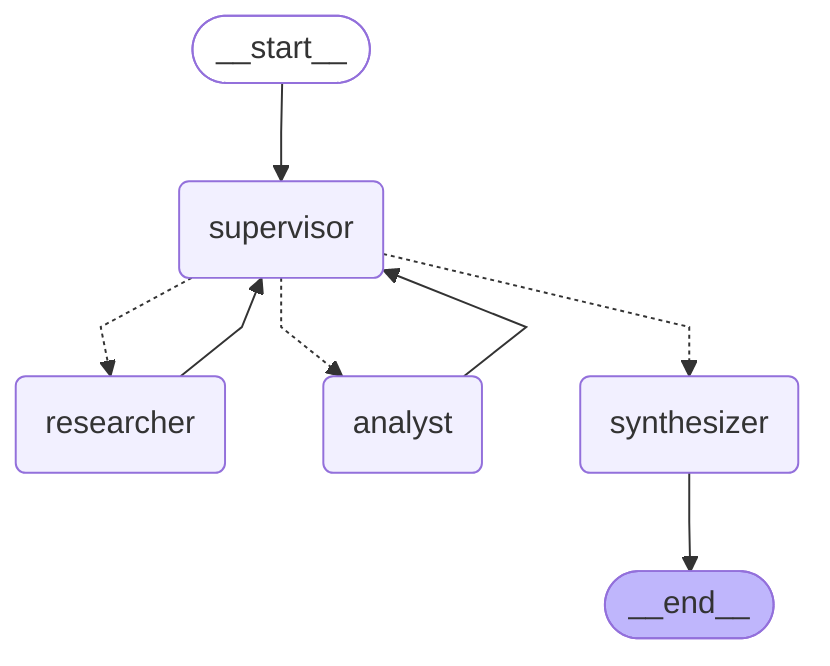
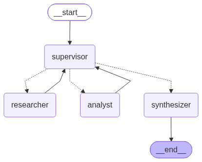

# Orquestador multi-agente de análisis e investigación

Prototipo en Python 3.12 + **LangGraph** de un orquestador **jerárquico**: un nodo
**Supervisor** recibe una consulta que mezcla dos dominios (datos documentales + cálculo),
delega en especialistas, **valida los resultados con una rúbrica** antes de terminar y
cierra con una **síntesis** que cita quién aportó cada dato.

- **Agente Investigador** (`agents/research_agent.py`): busca en la documentación de la
  librería ficticia *Caudal* con búsqueda híbrida (Pinecone + BM25) sobre el índice que
  armamos en la Pre-entrega 4.
- **Agente Analista** (`agents/analyst_agent.py`): calcula con herramientas seguras
  (aritmética por AST, estimación de lotes y tiempos con validación Pydantic).

Pre-entrega 6 del curso AI Engineering: "Orquestador Multi-Agente de Análisis e Investigación".

## Estructura

```
state.py                  # OrchestratorState(MessagesState): control de flujo + contribuciones por agente
graph.py                  # StateGraph: nodos, arista condicional del supervisor, recursion_limit
main.py                   # CLI: arma el grafo real (Gemini + Pinecone), corre la consulta y guarda la traza
agents/
  supervisor.py           # prompt con rúbrica, SupervisorDecision (Pydantic), tope de pasos, router Literal
  research_agent.py       # herramienta buscar_documentacion + create_react_agent del investigador
  analyst_agent.py        # herramientas calcular / estimar_tiempo_procesamiento + agente analista
  synthesizer.py          # respuesta final a partir de las contribuciones (único nodo que va a END)
  common.py               # cómo se invoca a un especialista aislado; RetryPolicy ante 429/503
providers.py              # ChatOpenAI compatible con Gemini (thought signatures), modelo por rol, limitador RPM
rag_system.py, corpus.py, config.py, data/   # RAG híbrido de la Pre-entrega 4 (copiado, no importado)
demo.ipynb                # notebook EJECUTADO contra Gemini + Pinecone reales: traza de delegación
trazas/                   # traza_demo.json y traza_demo.log de esa misma corrida
docs/grafo.mmd, grafo.png # diagrama del grafo generado con draw_mermaid() / draw_mermaid_png()
tests/                    # pytest sin red: modelos fake (tool calls y decisiones estructuradas), buscador fake
```

## Topología elegida y por qué



El diagrama de arriba es la salida literal de `graph.get_graph().draw_mermaid()` sobre el
grafo compilado (también en `docs/grafo.mmd`; la imagen, generada con `draw_mermaid_png()`,
está en `docs/grafo.png`). Las flechas punteadas son la **arista condicional** del
supervisor; las continuas, aristas fijas.



**Jerárquica (supervisor + especialistas en estrella)**, por estas razones:

1. **Un solo punto de decisión.** Solo el supervisor elige quién trabaja. Los especialistas
   nunca se llaman entre sí y siempre le devuelven el control (`researcher -> supervisor`,
   `analyst -> supervisor`). Así el flujo es auditable: cada salto queda registrado como
   una decisión con razón y rúbrica.
2. **Delegación dinámica, no un pipeline fijo.** El orden investigador → analista no está
   cableado: lo decide el LLM en cada turno según lo que falta. Si un resultado no alcanza,
   el supervisor puede volver a mandar al mismo especialista (refinamiento) o terminar.
3. **Especialistas acotados.** Cada uno tiene SOLO sus herramientas (el investigador no
   puede calcular, el analista no puede buscar). Eso hace que cada respuesta tenga un
   origen claro y evita que un agente “resuelva” lo que no le toca con datos inventados.
4. **Validación centralizada antes del END.** Como todo pasa por el supervisor, es el lugar
   natural para aplicar la rúbrica: nada llega a la síntesis sin pasar por ella.

Alternativas descartadas: un **pipeline secuencial** fijo (no permite refinar ni saltear
pasos), y una **red de agentes que se pasan el control entre sí** (handoffs): más flexible,
pero con dos especialistas agrega bucles difíciles de acotar y diluye quién decide.

### Las piezas del grafo

| Pieza | Dónde | Qué hace |
|---|---|---|
| `StateGraph(OrchestratorState)` | `graph.py:47` | Un `add_node` por agente: `supervisor`, `researcher`, `analyst`, `synthesizer` |
| Arista condicional | `graph.py:58` | `add_conditional_edges("supervisor", route_from_supervisor)` |
| Router tipado | `agents/supervisor.py:142` | `route_from_supervisor(state) -> Literal["researcher", "analyst", "synthesizer"]`: el `Literal` define los destinos (y el diagrama) |
| Decisión estructurada | `agents/supervisor.py:68`, `:96` | `SupervisorDecision` (Pydantic) con `next: Literal["researcher","analyst","FINISH"]`, `instruccion`, `razon`, `rubrica`; `with_structured_output(..., method="json_schema")` |
| Prompt del supervisor | `agents/supervisor.py:26` | "Dada la conversación actual, ¿quién debe intervenir ahora o es momento de finalizar?" + rúbrica |
| Especialistas | `agents/common.py:47` | `create_react_agent` de LangGraph, cada uno con su lista acotada de herramientas |
| Tope de pasos | `agents/supervisor.py:24`, `:102` | `MAX_STEPS = 6`: al pasarlo, el supervisor NO llama al LLM y fuerza la síntesis (`cierre_forzado=True`) |
| `recursion_limit` | `graph.py:30` (orquestador = 20), `agents/common.py:28` (cada especialista = 9) | Red de seguridad de LangGraph si algo se escapara del tope |
| Reintentos | `agents/common.py:30` | `RetryPolicy` en cada nodo con LLM: reintenta 429 por minuto y 5xx; NO reintenta la cuota diaria |

## Estado compartido (`state.py`)

`OrchestratorState` hereda de `MessagesState` y agrega:

| Campo | Para qué |
|---|---|
| `pregunta` | La consulta original (la lee el supervisor y la síntesis) |
| `next_agent` | Destino elegido por el supervisor; lo lee la arista condicional |
| `instruccion_actual` | La instrucción puntual para el especialista (lo único que recibe del supervisor) |
| `contributions: Annotated[list[Contribution], operator.add]` | **Quién aportó qué**: `agente`, `paso`, `tarea`, `resultado`, `fuentes`, `herramientas`, `llamadas`, `estado` (`ok`/`error`). El reducer concatena: ningún nodo pisa lo de otro |
| `decisiones: Annotated[list[Decision], operator.add]` | Cada decisión del supervisor con su razón y la rúbrica evaluada |
| `step_count`, `task_completed`, `cierre_forzado`, `final_answer` | Control del bucle y resultado |

Además, en `messages` cada nodo deja un `AIMessage` firmado con `name` (`supervisor`,
`researcher`, `analyst`, `synthesizer`), así el historial también muestra el autor.

## Validación de resultados (rúbrica del supervisor)

En cada turno el supervisor completa una `Rubrica` (Pydantic) con cuatro criterios:

1. **cobertura**: cada parte de la pregunta tiene respuesta.
2. **evidencia**: cada dato documental tiene fuente citada por el investigador.
3. **calculos**: cada número derivado lo calculó el analista **con una herramienta**.
4. **consistencia**: los datos que usó el analista coinciden con los del investigador.

Solo si los cuatro dan ✓ elige `FINISH`. Si alguno falla, devuelve la tarea al especialista
que puede arreglarlo con una instrucción de **refinamiento** que dice qué falta (lo prueba
`test_rubrica_pide_refinamiento_y_despues_termina`: supervisor → investigador → analista →
analista otra vez → cierre). Si se cierra con la rúbrica incompleta o por el tope de pasos,
la síntesis recibe un aviso y tiene que declarar el faltante en vez de rellenarlo.

Hay validación también en el nivel de las herramientas: `estimar_tiempo_procesamiento`
valida sus argumentos con el esquema `ParametrosEstimacion` (todo > 0) y `calcular` rechaza
cualquier cosa que no sea aritmética. Los errores vuelven **como dato** (`{"error", "sugerencia"}`)
y una contribución cuyas herramientas fallaron todas queda con `estado="error"`, visible
para el supervisor.

## Cómo se evita la contaminación de contexto

Los especialistas **no reciben `state["messages"]`**. `run_specialist` (`agents/common.py:80`)
les arma un único mensaje:

- **Investigador**: solo `Tarea: <instrucción del supervisor>`.
- **Analista**: la instrucción + los **resultados** del investigador con sus fuentes
  (`contexto_para_analista`, `agents/analyst_agent.py:172`), que son los datos sobre los que
  tiene que calcular. No ve la conversación del usuario, ni las decisiones del supervisor,
  ni los tool calls internos del investigador.

Lo comprueba `test_especialistas_no_reciben_el_historial_completo`: la pregunta lleva un
marcador que nunca aparece en lo que reciben los especialistas. A la vuelta, los mensajes
internos del especialista (tool calls, resultados crudos) tampoco suben al estado: solo la
`Contribution` resumida.

## Cómo se manejan los conflictos entre agentes

- **No hay negociación entre especialistas: arbitra el supervisor.** Los agentes no se
  hablan entre sí, así que un conflicto solo puede aparecer entre contribuciones, y el único
  que las compara es el supervisor, con el criterio **consistencia** de la rúbrica.
- **Si detecta una contradicción** (por ejemplo, el analista usó un tamaño de lote distinto
  del que citó el investigador), no termina: devuelve la tarea al especialista que tiene que
  corregir, con una instrucción que nombra el conflicto y el dato correcto.
- **Jerarquía de la evidencia**: un dato documental con fuente le gana a un supuesto. Por
  eso el analista tiene prohibido inventar datos (si falta uno, lo dice) y la síntesis tiene
  la regla de priorizar el dato con fuente y **mencionar** la discrepancia, no esconderla.
- **Trazabilidad**: como cada contribución guarda autor, tarea, herramientas y fuentes, un
  conflicto siempre se puede rastrear hasta el paso que lo introdujo.
- **Errores y bucles**: si un especialista falla dos veces en lo mismo, el supervisor cierra
  declarando el faltante; y `MAX_STEPS` garantiza que un desacuerdo que no converge no
  quede girando para siempre (cierre forzado + aviso a la síntesis).

## Demo real (`demo.ipynb`)

El notebook está **ejecutado** contra Gemini (endpoint compatible con OpenAI) y el índice
Pinecone `pre-entrega-4` / namespace `caudal-docs`, con las salidas guardadas. Pregunta:

> Según la documentación de Caudal, ¿cuál es el tamaño de lote (tamano_lote) por defecto y
> cuál se recomienda para cargas de ingesta masiva? Si tengo que procesar 2.000.000 de
> eventos con 4 workers y cada worker procesa 5 lotes por segundo, ¿cuántos lotes se forman
> y cuánto tardaría con cada uno de esos dos tamaños de lote?

Extracto de la traza real (`trazas/traza_demo.log`; recortado con `...` y la contribución del analista resumida en una línea, el texto completo está en el log):

```
[  18.6s] SUPERVISOR (turno 1) -> researcher
  rúbrica: cobertura=✗, evidencia=✗, calculos=✗, consistencia=✓
  instrucción: Busca en la documentación oficial de la librería Caudal el valor por defecto del parámetro 'tamano_lote' y el valor recomendado específicamente para escenarios de ingesta masiva. ...
[  62.6s] RESEARCHER (turno 1, estado ok)
  herramienta: buscar_documentacion({"consulta": "tamano_lote valor por defecto ingesta masiva recomendada"})
  herramienta: buscar_documentacion({"consulta": "tamano_lote ingesta masiva recomendada caudal-rendimiento"})
  contribución: * Valor por defecto de `tamano_lote`: 500 [caudal-instalacion › Configuración con CaudalConfig].
    * Valor recomendado para escenarios de ingesta masiva ...: 5000 eventos o más [caudal-rendimiento › Backpressure y tamaño de lote].
[  86.7s] SUPERVISOR (turno 2) -> analyst
  rúbrica: cobertura=✗, evidencia=✓, calculos=✗, consistencia=✓
[ 155.7s] ANALYST (turno 2, estado ok)
  herramienta: estimar_tiempo_procesamiento({"lotes_por_segundo_por_worker": 5, "workers": 4, "tamano_lote": 500, "registros": 2000000})
  herramienta: estimar_tiempo_procesamiento({"tamano_lote": 5000, "workers": 4, "registros": 2000000, "lotes_por_segundo_por_worker": 5})
  contribución: Escenario 1 (500): 4.000 lotes, 200 segundos. Escenario 2 (5000): 400 lotes, 20 segundos.
[ 171.7s] SUPERVISOR (turno 3) -> synthesizer
  rúbrica: cobertura=✓, evidencia=✓, calculos=✓, consistencia=✓
[ 240.5s] SYNTHESIZER
  respuesta final: ... Valor por defecto: 500 eventos [caudal-instalacion › Configuración con CaudalConfig] ...

Ruta: supervisor -> researcher -> supervisor -> analyst -> supervisor -> synthesizer
```

Modelos de esa corrida (uno por rol para repartir la cuota diaria del free tier):
supervisor y analista `gemini-3-flash-preview`, investigador `gemini-3.5-flash-lite`,
síntesis `gemini-3.1-flash-lite`. En `fuentes` de la contribución del investigador se
registran todos los fragmentos recuperados; los que efectivamente citó van entre corchetes
en su texto. Las salidas del notebook incluyen un `UserWarning` de serialización de Pydantic
(`field_name='parsed'`) que emite `langchain-openai` con `method="json_schema"`: es inocuo.

## Cómo correrlo

```bash
uv sync
cp .env.example .env        # completar PINECONE_API_KEY y OPENAI_API_KEY (y OPENAI_BASE_URL para Gemini)
uv run pytest -q            # 33 tests, sin red ni keys
uv run python main.py       # consulta demo; imprime la traza y la guarda en trazas/
uv run python main.py "¿Qué significa el error CAU-503 y cuántos lotes de 500 son 1.200.000 eventos?"
uv run python main.py --mermaid   # diagrama Mermaid del grafo
uv run jupyter nbconvert --to notebook --execute --inplace demo.ipynb   # re-ejecutar el notebook
```

Requisito: el índice Pinecone de la Pre-entrega 4 ya creado y cargado (`init_index.py` +
`ingest.py` de ese repo). Este repo reusa el corpus (`data/`) y el chunking determinista
para armar el BM25 con los mismos `chunk_id` que los vectores.

Variables opcionales: `SUPERVISOR_MODEL`, `RESEARCH_MODEL`, `ANALYST_MODEL`, `SYNTH_MODEL`
(modelo por rol; si faltan, `OPENAI_MODEL`), `LLM_RPM` (pedidos por minuto, compartido entre
roles) y `SUPERVISOR_STRUCTURED_METHOD` (`json_schema` o `function_calling`).

## Tests

`uv run pytest -q` → 33 tests sin red. Los modelos son fakes: `FakeToolModel` emite tool
calls guionadas para los especialistas y `FakeSupervisorModel` devuelve `SupervisorDecision`
desde su `with_structured_output`. El buscador es un `FakeRetriever`.

| Test | Qué demuestra |
|---|---|
| `test_ruta_supervisor_investigador_analista_cierre` | La ruta supervisor → researcher → supervisor → analyst → supervisor → synthesizer |
| `test_contribuciones_se_acumulan_con_autor_tarea_y_fuentes` | `contributions` acumula con autor, turno, tarea, herramientas y fuentes |
| `test_especialistas_no_reciben_el_historial_completo` | Aislamiento de contexto: system prompt + un único mensaje con la tarea |
| `test_rubrica_pide_refinamiento_y_despues_termina` | La rúbrica devuelve la tarea al analista y después cierra |
| `test_tope_de_pasos_corta_el_bucle_del_supervisor` | Un supervisor que nunca da FINISH se corta en `max_steps` con cierre forzado |
| `test_error_de_busqueda_queda_como_contribucion_con_error` | Pinecone caído → error como dato → contribución `estado=error` visible al supervisor |
| `tests/test_tools.py` | `calcular` rechaza `__import__`, `open`, nombres, lambdas, potencias gigantes; estimación validada con Pydantic; buscador con fuentes y con error |
| `tests/test_providers.py` | Modelo por rol, limitador compartido, thought signatures de Gemini, qué errores se reintentan |

## Decisiones y problemas encontrados

- **Thought signatures de Gemini**: en tool calling, Gemini devuelve una firma que exige
  recibir de vuelta; `ChatOpenAI` la descarta (400 en la segunda llamada). `ChatOpenAICompatible`
  (de la Pre-entrega 5) la guarda y la reinyecta.
- **Cuota del free tier**: 20 pedidos por día *por modelo*. Todo el desarrollo se hizo con
  fakes; las llamadas reales fueron solo las de la demo. Aprendimos que algunos nombres son
  **alias que comparten cuota** (`gemini-3.5-flash` consumía la de `gemini-3.6-flash`), que
  `gemini-2.5-flash` ya da 404 y que los 503 "high demand" son frecuentes: por eso hay
  modelo por rol y la `RetryPolicy` no reintenta el 429 de cuota diaria.
- **`create_react_agent`**: es lo que sugiere la consigna; en LangGraph 1.x está marcado como
  deprecado a favor de `langchain.agents.create_agent` (se elimina en 2.0). Funciona igual y
  el aviso se silencia solo en `crear_agente_react`.
- **Síntesis como nodo propio** en vez de que el supervisor redacte: separa "decidir" de
  "escribir" y deja un único nodo que va a `END`.

## Criterio → dónde se cumple

| Criterio (peso) | Dónde se cumple |
|---|---|
| **Documentación y Visualización (20 %)** | README: "Topología elegida y por qué", diagrama Mermaid generado con `draw_mermaid()` (+ `docs/grafo.mmd`, `docs/grafo.png`), "Cómo se manejan los conflictos entre agentes", "Cómo se evita la contaminación de contexto" |
| **Arquitectura y Flujo del Grafo (Supervisor) (35 %)** | `graph.py:47` `StateGraph`; `graph.py:48-55` `add_node` por agente; `graph.py:58` `add_conditional_edges`; `agents/supervisor.py:142` router `Literal[...]`; `agents/supervisor.py:68` decisión Pydantic; `agents/supervisor.py:24`/`:102` tope `MAX_STEPS`; `graph.py:30` `recursion_limit`; delegación real en `demo.ipynb` y `trazas/traza_demo.log` |
| **Especialización de Agentes y Herramientas (25 %)** | `agents/research_agent.py:53` `buscar_documentacion` (híbrida real Pinecone + BM25, error como dato en `:67`); `agents/analyst_agent.py:95` `calcular` (AST, sin `eval`, `:70`), `agents/analyst_agent.py:138` `estimar_tiempo_procesamiento` (Pydantic `:114`); `agents/common.py:47` `create_react_agent` con herramientas acotadas; tool calls reales en `trazas/traza_demo.json` |
| **Gestión de Estado y Validación (20 %)** | `state.py:51` `OrchestratorState(MessagesState)`; `state.py:55` `contributions` con `operator.add`; `state.py:28` `Contribution` (autor, tarea, resultado, fuentes); rúbrica `agents/supervisor.py:41` + `Rubrica` `:58`; aviso a la síntesis `agents/synthesizer.py:37`; tests `tests/test_graph.py:130` (refinamiento), `:153` (tope), `:84` (contribuciones), `:103` (contexto) |
